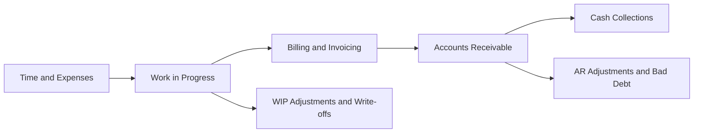
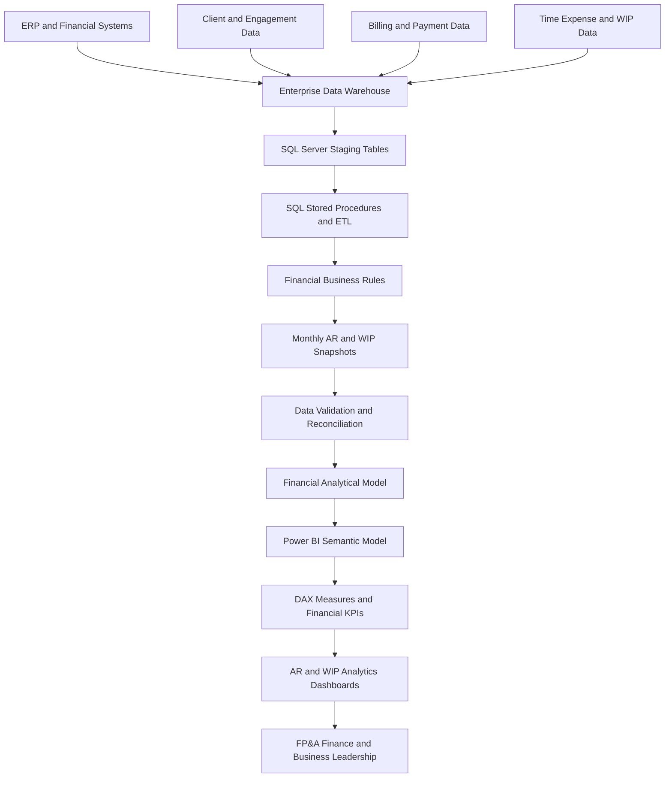
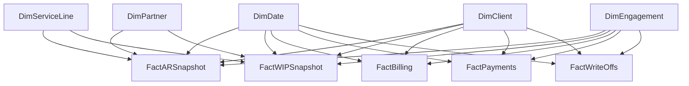
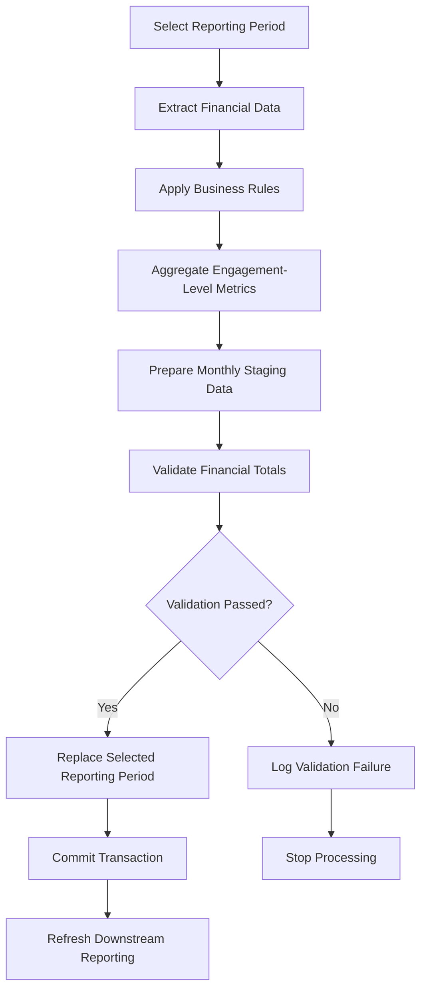

# Accounts Receivable & WIP Analytics

### End-to-End Financial Analytics & Working Capital Management Solution


---

## Project Overview

This project demonstrates an end-to-end financial analytics
solution designed to monitor Accounts Receivable (AR),
Work in Progress (WIP), cash collections, billing performance
and working capital exposure.

The solution integrates financial transactions, engagement
information, client master data, invoices, payments,
adjustments and write-offs into a centralized analytical model.

SQL-based data processing, automated monthly staging workflows
and interactive Power BI dashboards enable FP&A teams,
Finance teams and business leadership to monitor outstanding
balances, identify financial risks and support data-driven
working capital management.

---

## Business Impact

The solution is designed to support:

- Improved visibility into outstanding accounts receivable.
- Improved monitoring of unbilled work in progress.
- Identification of long-outstanding financial balances.
- Improved billing and collection prioritization.
- Standardized AR and WIP KPI definitions.
- Reduced dependency on manual financial reporting.
- Improved month-end reporting efficiency.
- Better visibility into write-offs and bad debt.
- Improved financial reconciliation and reporting accuracy.
- Data-driven working capital management.
- Improved engagement-level financial monitoring.

---

## Problem Statement

Professional services organizations manage large volumes
of engagement-related time entries, expenses, invoices,
payments and financial adjustments.

When financial information is distributed across multiple
transactional systems and manual reports, it becomes
difficult to establish a consolidated view of outstanding
receivables and unbilled work.

Key challenges include:

- Limited visibility into outstanding AR and WIP balances.
- Difficulty identifying long-outstanding invoices.
- Delays in converting eligible WIP into billed revenue.
- Manual preparation of monthly financial reports.
- Inconsistent financial KPI calculations.
- Limited visibility into engagement-level financial exposure.
- Difficulty tracking write-offs and bad debt.
- Financial reconciliation challenges.
- Limited understanding of collection performance.
- Delayed identification of working capital risks.

---

## Business Objectives

- Develop a centralized AR and WIP analytics solution.
- Monitor outstanding accounts receivable balances.
- Analyze AR aging and overdue invoices.
- Monitor unbilled work in progress.
- Identify aging WIP requiring billing review.
- Track cash collections and payment trends.
- Analyze financial write-offs and bad debt.
- Monitor client and engagement-level financial exposure.
- Automate monthly analytical staging processes.
- Standardize financial KPI definitions.
- Improve source-to-target financial reconciliation.
- Support working capital and revenue cycle management.

---

## Financial Lifecycle



### Work in Progress

WIP represents eligible work performed or expenses incurred
that have not yet been billed to the client.

### Accounts Receivable

AR represents outstanding amounts owed by clients
against issued invoices.

### Cash Collections

Cash collections represent payments received and applied
against outstanding client balances.

### Write-offs

Write-offs represent amounts removed from financial
balances according to approved business and accounting rules.

---

## Data Overview

### Data Sources

- ERP and financial transaction data
- Enterprise Data Warehouse
- Client master data
- Engagement and job information
- Employee time entry records
- Expense transactions
- Billing and invoice data
- Accounts receivable transactions
- Work in progress transactions
- Cash payment records
- Financial adjustments
- Write-off and cancellation records
- Bad debt transactions
- Organizational hierarchy information

### Data Granularity

- Financial transaction-level records
- Invoice-level outstanding balances
- Client-level financial performance
- Engagement-level financial performance
- Monthly engagement-level financial snapshots
- Service line and office-level reporting
- Historical reporting period analysis

### Important Data Fields

| Field | Description |
|---|---|
| ClientID | Unique client identifier |
| JobID | Unique engagement or job identifier |
| InvoiceID | Unique invoice identifier |
| ReportingDate | Financial reporting snapshot date |
| PeriodID | Financial reporting period identifier |
| InvoiceDate | Date of invoice generation |
| DueDate | Contractual invoice payment due date |
| TransactionDate | Financial transaction date |
| Hours | Recorded engagement hours |
| FeesAmount | Standard or recorded fee amount |
| ExpenseAmount | Engagement-related expenses |
| DirectCost | Direct engagement delivery costs |
| NetRevenue | Revenue after applicable adjustments |
| GrossMargin | Net revenue less direct costs |
| WIPBalance | Outstanding unbilled work |
| ARBalance | Outstanding accounts receivable |
| PaymentAmount | Cash payments received |
| AdjustmentAmount | Financial adjustments |
| WriteOffAmount | Approved financial write-offs |
| BadDebtAmount | Bad debt amounts |
| ServiceLineID | Service line identifier |
| PartnerID | Responsible engagement partner |
| OfficeID | Office identifier |

---

## Solution Architecture



---

## Technology Stack

| Technology | Purpose |
|---|---|
| SQL Server | Financial data storage and extraction |
| T-SQL | Financial data transformation and analysis |
| Stored Procedures | Automated monthly staging processes |
| Enterprise Data Warehouse | Centralized financial data source |
| Power BI | Interactive financial dashboards |
| DAX | Financial KPI calculations |
| Power Query | Data preparation and transformation |
| Excel | Financial validation and reconciliation |
| GitHub | Version control and documentation |

---

## Data Model

The analytical solution follows dimensional modeling
principles to support scalable financial reporting.

### Representative Fact Tables

| Table | Description |
|---|---|
| FactARSnapshot | Invoice-level outstanding AR balances |
| FactWIPSnapshot | Engagement-level outstanding WIP balances |
| FactBilling | Billing and invoice transactions |
| FactPayments | Cash payment transactions |
| FactWriteOffs | AR and WIP write-off transactions |
| FactFinancialPerformance | Revenue, costs and profitability |
| FactAdjustments | Financial adjustment transactions |

### Representative Dimension Tables

| Table | Description |
|---|---|
| DimDate | Calendar and reporting periods |
| DimClient | Client master information |
| DimEngagement | Engagement and job information |
| DimServiceLine | Service line classification |
| DimPartner | Engagement partner information |
| DimOffice | Office and location information |
| DimIndustry | Client industry classification |
| DimWorkType | Engagement work classification |

### Semantic Model



### Relationship Design

- One-to-many relationships between dimensions and facts.
- Shared client, engagement and date dimensions.
- Clearly defined granularity for every fact table.
- Consistent financial reporting periods.
- Single-direction filtering where appropriate.
- Separate transactional and snapshot-based metrics.
- Avoidance of unnecessary many-to-many relationships.
- Prevention of duplicate financial amounts during joins.

AR and WIP balances are semi-additive metrics.
Balances can be aggregated across clients and engagements
at a specific reporting date but should not be summed
across multiple historical reporting dates.

---

## Implementation Approach

### 1. Business Requirement Analysis

- Understand financial reporting requirements.
- Identify AR and WIP business definitions.
- Define financial reporting periods.
- Establish aging calculation rules.
- Identify important financial KPIs.
- Define client and engagement-level reporting requirements.

### 2. Data Extraction

- Extract financial transactions from source systems.
- Retrieve client and engagement master information.
- Extract billing and invoice transactions.
- Retrieve payment and adjustment transactions.
- Extract WIP, write-off and bad debt information.
- Apply appropriate financial reporting period filters.

### 3. Data Transformation

- Develop SQL-based transformation logic.
- Use joins, CTEs and window functions.
- Standardize client and engagement identifiers.
- Apply financial business rules.
- Aggregate financial transactions at the required granularity.
- Handle null values and duplicate records.
- Classify write-offs and financial adjustments.
- Calculate reporting dates and financial periods.

### 4. Monthly Staging Table Development

- Develop monthly engagement-level analytical tables.
- Calculate financial metrics for each reporting period.
- Maintain historical financial snapshots.
- Integrate AR and WIP balances.
- Include client and engagement classifications.
- Support period-specific reprocessing.
- Prevent duplicate engagement and reporting period records.

### 5. AR Aging Calculation

- Identify outstanding invoices.
- Determine the applicable invoice due date.
- Calculate overdue days as of the reporting date.
- Classify outstanding balances into aging buckets.
- Identify long-outstanding receivables.
- Aggregate aging balances across business dimensions.

### 6. WIP Aging Calculation

- Identify outstanding unbilled transactions.
- Determine the original work or transaction date.
- Calculate the age of outstanding WIP.
- Classify WIP balances into aging buckets.
- Identify engagements requiring billing review.
- Monitor unbilled work across service lines.

### 7. Cash Collection and Write-off Analysis

- Analyze payments received from clients.
- Monitor cash collection trends.
- Analyze AR and WIP write-offs separately.
- Identify financial adjustment trends.
- Monitor bad debt exposure.
- Reconcile financial transaction classifications.

### 8. Data Quality and Validation

- Validate source and destination record counts.
- Reconcile AR balances against financial source reports.
- Reconcile WIP balances against financial source reports.
- Validate payment and write-off amounts.
- Identify missing client and engagement identifiers.
- Validate reporting period consistency.
- Check for duplicate analytical records.
- Validate financial business rules.

### 9. Data Modeling

- Develop fact and dimension tables.
- Establish appropriate table relationships.
- Build a centralized Power BI semantic model.
- Develop reusable DAX measures.
- Optimize the model for financial reporting.

### 10. Dashboard Development

- Develop interactive financial dashboards.
- Create AR and WIP scorecards.
- Analyze aging balances.
- Monitor cash collection performance.
- Analyze write-offs and bad debt.
- Implement drill-down and filtering capabilities.
- Present financial insights to business stakeholders.

---

## Key Performance Indicators

| KPI | Business Definition |
|---|---|
| Total AR Balance | Outstanding accounts receivable as of the reporting date |
| Total WIP Balance | Outstanding unbilled work as of the reporting date |
| Total Billing | Invoice amounts generated during the selected period |
| Cash Collections | Cash payments received during the selected period |
| Overdue AR | Outstanding positive invoice balances past their due dates |
| Overdue AR % | Overdue AR relative to eligible positive AR balances |
| AR Aging | Classification of outstanding invoices by overdue days |
| WIP Aging | Classification of unbilled work by transaction age |
| WIP Write-offs | Amounts written off from unbilled work |
| AR Write-offs | Amounts written off from receivable balances |
| Bad Debt | Amounts classified as bad debt under accounting rules |
| Net Revenue | Revenue after applicable financial adjustments |
| Gross Margin | Net revenue less direct costs |
| Realization % | Realized revenue relative to standard billable value |
| DSO | Estimated number of days required to collect receivables |
| Combined AR and WIP Exposure | Total outstanding AR and WIP balances |

Combined AR and WIP exposure is an operational financial
metric and should not be interpreted as total accounting
working capital.

---

## AR Aging Classification

AR aging is calculated using the invoice due date
and the selected financial reporting date.

| Aging Bucket | Description |
|---|---|
| Current | Invoice is not yet overdue |
| 1-30 Days | Outstanding for 1 to 30 days past due |
| 31-60 Days | Outstanding for 31 to 60 days past due |
| 61-90 Days | Outstanding for 61 to 90 days past due |
| 91-120 Days | Outstanding for 91 to 120 days past due |
| 121+ Days | Outstanding for more than 120 days |
| Unknown | Missing invoice due date |

---

## WIP Aging Classification

WIP aging is calculated using the original transaction
or work date and the selected reporting date.

| Aging Bucket | Description |
|---|---|
| 0-30 Days | Recently recorded unbilled work |
| 31-60 Days | Unbilled work aged 31 to 60 days |
| 61-90 Days | Unbilled work aged 61 to 90 days |
| 91-120 Days | Unbilled work aged 91 to 120 days |
| 121+ Days | Long-outstanding unbilled work |
| Unknown | Missing or invalid transaction date |

Aging thresholds should be aligned with the applicable
financial reporting and billing policies.

---

## Sample SQL Implementation

The following SQL Server examples demonstrate representative
financial analytics and transformation patterns.

### 1. Monthly Engagement-Level Financial Aggregation

```sql
SELECT
    ClientID,
    JobID,
    EOMONTH(TransactionDate) AS ReportingMonth,

    SUM(Hours) AS TotalHours,

    SUM(FeesAmount) AS TotalFees,

    SUM(ExpenseAmount) AS TotalExpenses,

    SUM(NetRevenue) AS NetRevenue,

    SUM(DirectCost) AS DirectCost,

    SUM(NetRevenue) - SUM(DirectCost)
        AS GrossMargin

FROM FinancialTransactions

GROUP BY
    ClientID,
    JobID,
    EOMONTH(TransactionDate);
```

This query aggregates financial transactions at
client, engagement and monthly reporting granularity.

---

### 2. Accounts Receivable Aging

```sql
DECLARE @ReportingDate DATE = '2026-10-31';

WITH ARAging AS
(
    SELECT
        ClientID,
        JobID,
        InvoiceID,
        InvoiceDate,
        DueDate,
        OutstandingAmount,

        DATEDIFF(
            DAY,
            DueDate,
            @ReportingDate
        ) AS OverdueDays

    FROM FactARSnapshot

    WHERE SnapshotDate = @ReportingDate
      AND OutstandingAmount > 0
)
SELECT
    ClientID,
    JobID,
    InvoiceID,
    OutstandingAmount,
    OverdueDays,

    CASE
        WHEN DueDate IS NULL
            THEN 'Unknown'
        WHEN OverdueDays <= 0
            THEN 'Current'
        WHEN OverdueDays <= 30
            THEN '1-30 Days'
        WHEN OverdueDays <= 60
            THEN '31-60 Days'
        WHEN OverdueDays <= 90
            THEN '61-90 Days'
        WHEN OverdueDays <= 120
            THEN '91-120 Days'
        ELSE '121+ Days'
    END AS AgingBucket

FROM ARAging;
```

This query classifies outstanding positive invoice
balances according to overdue days.

Credit balances should be reconciled separately.

---

### 3. WIP Aging Analysis

```sql
DECLARE @ReportingDate DATE = '2026-10-31';

WITH WIPAging AS
(
    SELECT
        ClientID,
        JobID,
        TransactionDate,
        OutstandingWIP,

        DATEDIFF(
            DAY,
            TransactionDate,
            @ReportingDate
        ) AS WIPAgeDays

    FROM FactWIPTransactionSnapshot

    WHERE SnapshotDate = @ReportingDate
      AND OutstandingWIP > 0
)
SELECT
    ClientID,
    JobID,
    OutstandingWIP,
    WIPAgeDays,

    CASE
        WHEN WIPAgeDays IS NULL
          OR WIPAgeDays < 0
            THEN 'Unknown'
        WHEN WIPAgeDays <= 30
            THEN '0-30 Days'
        WHEN WIPAgeDays <= 60
            THEN '31-60 Days'
        WHEN WIPAgeDays <= 90
            THEN '61-90 Days'
        WHEN WIPAgeDays <= 120
            THEN '91-120 Days'
        ELSE '121+ Days'
    END AS WIPAgingBucket

FROM WIPAging;
```

This analysis identifies outstanding unbilled work
requiring billing or engagement-level review.

---

### 4. Combined AR and WIP Exposure

```sql
DECLARE @ReportingDate DATE = '2026-10-31';

WITH AR AS
(
    SELECT
        ClientID,
        JobID,
        SUM(OutstandingAmount) AS ARBalance

    FROM FactARSnapshot

    WHERE SnapshotDate = @ReportingDate

    GROUP BY ClientID, JobID
),
WIP AS
(
    SELECT
        ClientID,
        JobID,
        SUM(WIPBalance) AS WIPBalance

    FROM FactWIPSnapshot

    WHERE SnapshotDate = @ReportingDate

    GROUP BY ClientID, JobID
)
SELECT
    COALESCE(A.ClientID, W.ClientID) AS ClientID,

    COALESCE(A.JobID, W.JobID) AS JobID,

    COALESCE(A.ARBalance, 0) AS ARBalance,

    COALESCE(W.WIPBalance, 0) AS WIPBalance,

    COALESCE(A.ARBalance, 0) +
    COALESCE(W.WIPBalance, 0)
        AS TotalFinancialExposure

FROM AR A

FULL OUTER JOIN WIP W
    ON A.ClientID = W.ClientID
   AND A.JobID = W.JobID;
```

AR and WIP data are aggregated separately before
joining to prevent financial duplication caused
by different source data granularities.

---

### 5. Top 10 Clients by Overdue AR

```sql
DECLARE @ReportingDate DATE = '2026-10-31';

SELECT TOP 10
    ClientID,

    SUM(OutstandingAmount)
        AS OverdueARBalance,

    COUNT(DISTINCT InvoiceID)
        AS OutstandingInvoices

FROM FactARSnapshot

WHERE SnapshotDate = @ReportingDate
  AND DueDate < @ReportingDate
  AND OutstandingAmount > 0

GROUP BY ClientID

ORDER BY OverdueARBalance DESC;
```

This analysis supports collection prioritization
based on outstanding overdue balances.

---

### 6. Monthly Cash Collection Analysis

```sql
SELECT
    EOMONTH(PaymentDate) AS ReportingMonth,

    SUM(PaymentAmount) AS CashCollections,

    COUNT(DISTINCT ClientID)
        AS PayingClients

FROM FactPayments

GROUP BY EOMONTH(PaymentDate)

ORDER BY ReportingMonth;
```

---

### 7. Write-off Analysis by Service Line

```sql
SELECT
    EOMONTH(TransactionDate) AS ReportingMonth,

    ServiceLineID,

    SUM(
        CASE
            WHEN WriteOffType = 'AR'
            THEN WriteOffAmount
            ELSE 0
        END
    ) AS ARWriteOffs,

    SUM(
        CASE
            WHEN WriteOffType = 'WIP'
            THEN WriteOffAmount
            ELSE 0
        END
    ) AS WIPWriteOffs,

    SUM(WriteOffAmount) AS TotalWriteOffs

FROM FactWriteOffs

GROUP BY
    EOMONTH(TransactionDate),
    ServiceLineID;
```

The calculation assumes write-off amounts are stored
using a standardized positive reporting convention.

---

## Monthly ETL and Staging Automation

Monthly financial reporting requires consistent
processing, validation and historical data retention.

### ETL Workflow



### Sample SQL Stored Procedure

```sql
CREATE OR ALTER PROCEDURE dbo.usp_LoadMonthlyFinancialSnapshot
    @ReportingDate DATE
AS
BEGIN

    SET NOCOUNT ON;
    SET XACT_ABORT ON;

    IF @ReportingDate IS NULL
       OR @ReportingDate <> EOMONTH(@ReportingDate)
    BEGIN
        THROW 50001,
            'A valid month-end reporting date is required.',
            1;
    END;

    BEGIN TRY

        SELECT
            ClientID,
            JobID,
            ReportingDate,
            NetRevenue,
            DirectCost,
            ARBalance,
            WIPBalance

        INTO #MonthlySnapshot

        FROM dbo.vw_MonthlyFinancialSnapshot

        WHERE ReportingDate = @ReportingDate;

        IF NOT EXISTS
        (
            SELECT 1
            FROM #MonthlySnapshot
        )
        BEGIN
            THROW 50002,
                'No source data found for the reporting period.',
                1;
        END;

        IF EXISTS
        (
            SELECT 1
            FROM #MonthlySnapshot
            WHERE ClientID IS NULL
               OR JobID IS NULL
        )
        BEGIN
            THROW 50003,
                'Missing client or engagement identifiers.',
                1;
        END;

        IF EXISTS
        (
            SELECT
                ClientID,
                JobID,
                ReportingDate
            FROM #MonthlySnapshot
            GROUP BY
                ClientID,
                JobID,
                ReportingDate
            HAVING COUNT(*) > 1
        )
        BEGIN
            THROW 50004,
                'Duplicate financial snapshot records detected.',
                1;
        END;

        BEGIN TRANSACTION;

        DELETE FROM dbo.MonthlyFinancialSnapshot

        WHERE ReportingDate = @ReportingDate;

        INSERT INTO dbo.MonthlyFinancialSnapshot
        (
            ClientID,
            JobID,
            ReportingDate,
            NetRevenue,
            DirectCost,
            ARBalance,
            WIPBalance
        )
        SELECT
            ClientID,
            JobID,
            ReportingDate,
            NetRevenue,
            DirectCost,
            ARBalance,
            WIPBalance

        FROM #MonthlySnapshot;

        COMMIT TRANSACTION;

    END TRY

    BEGIN CATCH

        IF @@TRANCOUNT > 0
            ROLLBACK TRANSACTION;

        THROW;

    END CATCH;

END;
```

This stored procedure demonstrates controlled
period-specific reprocessing, duplicate validation
and transaction-based error handling.

Production implementations should also include
financial reconciliation, execution logging,
concurrency controls and a unique target key.

---

## Sample DAX Measures

The following examples assume a shared date dimension
and complete month-end AR and WIP snapshots.

### Reporting Snapshot Date

```dax
Reporting Snapshot Date =
MAX(DimDate[Date])
```

For snapshot reporting, the date context should represent
a valid available reporting date, typically month-end.

### Total AR Balance

```dax
Total AR Balance =
VAR ReportingDate =
    [Reporting Snapshot Date]
RETURN
    CALCULATE(
        SUM(FactARSnapshot[OutstandingAmount]),
        FactARSnapshot[SnapshotDate] = ReportingDate
    )
```

### Total WIP Balance

```dax
Total WIP Balance =
VAR ReportingDate =
    [Reporting Snapshot Date]
RETURN
    CALCULATE(
        SUM(FactWIPSnapshot[WIPBalance]),
        FactWIPSnapshot[SnapshotDate] = ReportingDate
    )
```

### Total Financial Exposure

```dax
Total Financial Exposure =
IF(
    NOT ISBLANK([Total AR Balance])
        || NOT ISBLANK([Total WIP Balance]),
    COALESCE([Total AR Balance], 0)
        + COALESCE([Total WIP Balance], 0)
)
```

### Positive AR Balance

```dax
Positive AR Balance =
CALCULATE(
    [Total AR Balance],
    FactARSnapshot[OutstandingAmount] > 0
)
```

### Overdue AR Balance

```dax
Overdue AR Balance =
VAR ReportingDate =
    [Reporting Snapshot Date]
RETURN
    CALCULATE(
        [Total AR Balance],
        FactARSnapshot[OutstandingAmount] > 0,
        NOT ISBLANK(FactARSnapshot[DueDate]),
        FactARSnapshot[DueDate] < ReportingDate
    )
```

### Overdue AR Percentage

```dax
Overdue AR % =
DIVIDE(
    [Overdue AR Balance],
    [Positive AR Balance]
)
```

### AR Above 90 Days

```dax
AR Above 90 Days =
VAR ReportingDate =
    [Reporting Snapshot Date]
RETURN
    CALCULATE(
        [Total AR Balance],
        FactARSnapshot[OutstandingAmount] > 0,
        NOT ISBLANK(FactARSnapshot[DueDate]),
        FactARSnapshot[DueDate] < ReportingDate - 90
    )
```

### WIP Above 90 Days

```dax
WIP Above 90 Days =
CALCULATE(
    [Total WIP Balance],
    FactWIPSnapshot[WIPAgeDays] > 90,
    FactWIPSnapshot[WIPBalance] > 0
)
```

This measure assumes the WIP fact table contains
age-level balance information.

### Total Billing

```dax
Total Billing =
SUM(FactBilling[InvoiceAmount])
```

### Cash Collections

```dax
Cash Collections =
SUM(FactPayments[PaymentAmount])
```

### Total AR Write-offs

```dax
AR Write-offs =
CALCULATE(
    SUM(FactWriteOffs[WriteOffAmount]),
    FactWriteOffs[WriteOffType] = "AR"
)
```

### Total WIP Write-offs

```dax
WIP Write-offs =
CALCULATE(
    SUM(FactWriteOffs[WriteOffAmount]),
    FactWriteOffs[WriteOffType] = "WIP"
)
```

### Total Write-offs

```dax
Total Write-offs =
[AR Write-offs] + [WIP Write-offs]
```

### Bad Debt

```dax
Bad Debt =
SUM(
    FactFinancialPerformance[BadDebtAmount]
)
```

### Net Revenue

```dax
Net Revenue =
SUM(
    FactFinancialPerformance[NetRevenue]
)
```

### Gross Margin

```dax
Gross Margin =
[Net Revenue] -
SUM(FactFinancialPerformance[DirectCost])
```

### Realization Percentage

```dax
Realization % =
DIVIDE(
    [Net Revenue],
    SUM(
        FactFinancialPerformance[StandardBillableValue]
    )
)
```

Realization definitions should be aligned with
the applicable financial reporting policy.

### Previous Month AR Balance

```dax
Previous Month AR =
VAR PreviousMonthEnd =
    EOMONTH([Reporting Snapshot Date], -1)
RETURN
    CALCULATE(
        SUM(FactARSnapshot[OutstandingAmount]),
        REMOVEFILTERS(DimDate),
        FactARSnapshot[SnapshotDate] = PreviousMonthEnd
    )
```

### AR Month-over-Month Change

```dax
AR MoM Change =
IF(
    NOT ISBLANK([Previous Month AR])
        && NOT ISBLANK([Total AR Balance]),
    [Total AR Balance] - [Previous Month AR]
)
```

### AR Month-over-Month Change Percentage

```dax
AR MoM Change % =
DIVIDE(
    [AR MoM Change],
    [Previous Month AR]
)
```

### Days Sales Outstanding

```dax
Credit Sales =
SUM(FactBilling[CreditSalesAmount])
```

```dax
Days Sales Outstanding =
VAR DaysInPeriod =
    COUNTROWS(VALUES(DimDate[Date]))
RETURN
    DIVIDE(
        [Total AR Balance],
        [Credit Sales]
    ) * DaysInPeriod
```

This is a simplified ending-balance DSO calculation.

The selected period must contain complete dates,
and receivables and credit sales should use
consistent accounting and tax treatment.

---

## Data Quality and Financial Reconciliation

Financial reporting requires accurate and consistent
source-to-target reconciliation.

### Validation Controls

| Validation | Purpose |
|---|---|
| Record Count Validation | Verify completeness of processed records |
| Duplicate Detection | Prevent duplicate financial snapshots |
| AR Reconciliation | Match analytical AR against source reports |
| WIP Reconciliation | Match analytical WIP against source reports |
| Billing Validation | Verify invoice amounts |
| Payment Reconciliation | Validate cash payment totals |
| Write-off Validation | Verify write-off classifications and amounts |
| Period Validation | Ensure correct financial reporting periods |
| Client Validation | Verify valid client identifiers |
| Engagement Validation | Verify valid engagement identifiers |
| Aging Validation | Verify aging bucket calculations |
| Revenue Validation | Reconcile reported revenue totals |

### Sample Financial Reconciliation Query

```sql
DECLARE @ReportingDate DATE = '2026-10-31';

WITH SourceTotals AS
(
    SELECT
        COUNT_BIG(*) AS RecordCount,
        SUM(ARBalance) AS SourceAR,
        SUM(WIPBalance) AS SourceWIP

    FROM dbo.SourceFinancialSnapshot

    WHERE ReportingDate = @ReportingDate
),
TargetTotals AS
(
    SELECT
        COUNT_BIG(*) AS RecordCount,
        SUM(ARBalance) AS TargetAR,
        SUM(WIPBalance) AS TargetWIP

    FROM dbo.MonthlyFinancialSnapshot

    WHERE ReportingDate = @ReportingDate
)
SELECT
    S.RecordCount AS SourceRecordCount,
    T.RecordCount AS TargetRecordCount,

    S.SourceAR,
    T.TargetAR,

    S.SourceAR - T.TargetAR
        AS ARDifference,

    S.SourceWIP,
    T.TargetWIP,

    S.SourceWIP - T.TargetWIP
        AS WIPDifference,

    CASE
        WHEN S.RecordCount = 0
          OR T.RecordCount = 0
          OR S.SourceAR IS NULL
          OR T.TargetAR IS NULL
          OR S.SourceWIP IS NULL
          OR T.TargetWIP IS NULL
            THEN 'Missing Data'

        WHEN ABS(S.SourceAR - T.TargetAR) <= 0.01
         AND ABS(S.SourceWIP - T.TargetWIP) <= 0.01
            THEN 'Passed'

        ELSE 'Failed'
    END AS ValidationStatus

FROM SourceTotals S

CROSS JOIN TargetTotals T;
```

The reconciliation compares source and target
financial balances for the same reporting period.

Detailed client and engagement-level reconciliation
should also be performed to identify offsetting differences.

---

## Dashboard Pages

### 1. Executive Financial Overview

- Total AR balance
- Total WIP balance
- Combined financial exposure
- Total billing
- Cash collections
- Total write-offs
- Monthly AR and WIP trends
- Financial exposure by service line

### 2. Accounts Receivable Aging

- Outstanding receivables
- Current and overdue balances
- AR aging bucket distribution
- AR above 90 days
- Overdue AR percentage
- Top clients by outstanding AR
- Engagement-level outstanding invoices
- AR aging by service line and office

### 3. Work in Progress Analysis

- Total outstanding WIP
- WIP aging distribution
- WIP above 90 days
- Unbilled work by engagement
- WIP by service line
- WIP by responsible partner
- Historical WIP trends
- Engagements requiring billing review

### 4. Cash Collection Analysis

- Monthly cash collections
- Collection trends
- Payments by client
- Payments by service line
- Billing versus cash collections
- Days Sales Outstanding
- Collection performance over time

### 5. Write-off and Bad Debt Analysis

- Total financial write-offs
- AR write-offs
- WIP write-offs
- Bad debt amounts
- Write-off trends
- Write-offs by client
- Write-offs by engagement
- Write-offs by service line

### 6. Client and Engagement Analysis

- Client-level financial exposure
- Engagement-level AR and WIP balances
- Net revenue
- Gross margin
- Realization percentage
- Outstanding financial balances
- Long-outstanding engagements
- Client financial performance trends

---

## Dashboard Preview

<!-- Upload actual project screenshots before enabling links. -->

<!--
### Executive Financial Overview


### Accounts Receivable Aging


### Work in Progress Analysis


### Cash Collection Analysis


### Write-off and Bad Debt Analysis


### Client and Engagement Analysis


### Semantic Model


-->

---

## Business Insights

The solution supports identification of:

- Clients contributing disproportionately to overdue AR.
- Engagements with long-outstanding WIP balances.
- Service lines with increasing financial exposure.
- Changes in receivable balances across reporting periods.
- Potential delays in converting WIP into invoices.
- Clients with recurring payment delays.
- Engagements with significant financial write-offs.
- Service lines with increasing bad debt exposure.
- Differences between billing and cash collection trends.
- Opportunities for improving working capital management.

---

## Business Recommendations

- Prioritize collection activities based on overdue balances.
- Review invoices outstanding for extended periods.
- Monitor engagements with aging WIP balances.
- Investigate delays in billing eligible work.
- Review recurring write-offs and financial adjustments.
- Monitor collection performance across service lines.
- Evaluate client-level financial exposure regularly.
- Establish standardized AR and WIP reporting definitions.
- Strengthen monthly financial reconciliation controls.
- Improve reporting automation and data availability.

---

## Performance Optimization

The solution incorporates SQL and Power BI performance
optimization considerations such as:

- Early filtering by financial reporting period.
- Appropriate indexing of join and filter columns.
- Aggregation before joining transactional datasets.
- Reusable SQL stored procedures.
- Period-specific staging table updates.
- Incremental processing where applicable.
- Avoidance of unnecessary many-to-many relationships.
- Efficient dimensional data modeling.
- Reusable DAX measures.
- Reduced duplication of transformation logic.
- Monitoring query and report execution performance.

---

## Security and Governance

- Standardized financial KPI definitions.
- Documented financial business rules.
- Controlled access to financial information.
- Source-to-target reconciliation.
- Data lineage and reporting traceability.
- Reporting period validation.
- Consistent client and engagement identifiers.
- Appropriate Power BI access permissions.
- Row-level security where required.
- Protection of confidential client information.
- Documented month-end processing workflows.

---

## Repository Structure

```text
accounts-receivable-wip-analytics/
│
├── README.md
│
├── datasets/
│   ├── client_master.csv
│   ├── engagement_master.csv
│   ├── ar_snapshot.csv
│   ├── wip_snapshot.csv
│   ├── billing_transactions.csv
│   ├── payment_transactions.csv
│   └── write_off_transactions.csv
│
├── sql/
│   ├── data_extraction.sql
│   ├── data_transformation.sql
│   ├── ar_aging_calculation.sql
│   ├── wip_aging_calculation.sql
│   ├── monthly_snapshot_etl.sql
│   ├── cash_collection_analysis.sql
│   ├── write_off_analysis.sql
│   └── financial_reconciliation.sql
│
├── powerbi/
│   └── ar_wip_analytics.pbix
│
├── architecture/
│   ├── solution_architecture.png
│   ├── financial_lifecycle.png
│   └── semantic_model.png
│
├── screenshots/
│   ├── executive-overview.png
│   ├── ar-aging-analysis.png
│   ├── wip-analysis.png
│   ├── cash-collection-analysis.png
│   ├── write-off-analysis.png
│   ├── engagement-analysis.png
│   └── semantic-model.png
│
└── documentation/
    ├── data_dictionary.md
    ├── kpi_definitions.md
    ├── financial_business_rules.md
    ├── etl_documentation.md
    └── validation_checklist.md
```

---

## Skills Demonstrated

- Advanced SQL and T-SQL
- SQL Stored Procedure Development
- Financial Planning and Analysis
- Accounts Receivable Analytics
- Work in Progress Analytics
- Working Capital Management
- Revenue Cycle Analytics
- AR and WIP Aging Analysis
- Cash Collection Analytics
- Write-off and Bad Debt Analysis
- Financial Performance Analysis
- Month-End Reporting
- ETL and Reporting Automation
- Power BI Dashboard Development
- DAX and Power Query
- Dimensional Data Modeling
- Financial Data Reconciliation
- Data Quality and Governance
- Business Intelligence
- Stakeholder Reporting

---

## Conclusion

This project demonstrates how financial transactions,
client information, engagement data, invoices and payments
can be transformed into a centralized financial analytics
solution.

By combining SQL-based data processing, automated monthly
staging workflows, dimensional modeling and Power BI,
the solution supports accounts receivable monitoring,
WIP analysis, cash collection tracking and financial
decision-making.

The project highlights the importance of reliable financial
data, standardized business definitions, automated reporting
and actionable insights in effective working capital
management.

---

## Author

**Jaydeep Hanumante**

Data & Business Intelligence Professional |
Microsoft Certified: Fabric Data Engineer Associate (DP-700)

[GitHub Profile](https://github.com/JaydeepHanumante)
